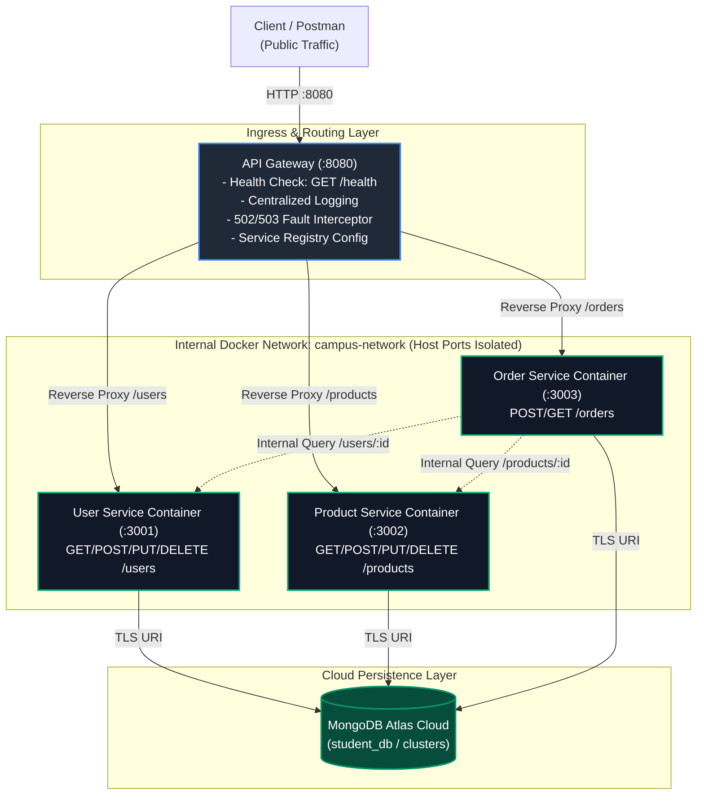

# LAB 7: API Gateway, Service Discovery & Cloud Deployment
**Course:** Web Services and SOA Laboratory  
**Technology Stack:** Docker, Docker Compose, Node.js (v20-alpine), Express.js, `http-proxy-middleware`, MongoDB Atlas, Render / Cloud PaaS  
**Architecture:** Single-Entry API Gateway, Config-Based Service Discovery, Network-Isolated Microservices, Cloud Application Layer  

---

## 📋 Table of Contents
1. [Executive Summary & Full-Stack Flow](#1-executive-summary--full-stack-flow)
2. [End-to-End Microservices Architecture](#2-end-to-end-microservices-architecture)
3. [Part A: API Gateway Implementation](#3-part-a-api-gateway-implementation)
   - [3.1 Gateway Architecture & Routing](#31-gateway-architecture--routing)
   - [3.2 Health Check Endpoint (`GET /health`)](#32-health-check-endpoint-get-health)
   - [3.3 Centralized Request Logging](#33-centralized-request-logging)
   - [3.4 Centralized Fault Handling (502/503 Resilience)](#34-centralized-fault-handling-502503-resilience)
   - [3.5 Network & Port Isolation Strategy](#35-network--port-isolation-strategy)
   - [3.6 Discussion: Why Introduce an API Gateway?](#36-discussion-why-introduce-an-api-gateway)
4. [Part B: Service Discovery (Configuration-Based)](#4-part-b-service-discovery-configuration-based)
   - [4.1 Service Registry via Externalized Configuration](#41-service-registry-via-externalized-configuration)
   - [4.2 Verification of Config Change Without Code Modification](#42-verification-of-config-change-without-code-modification)
   - [4.3 Discussion: Static/Config-Based vs. Dynamic Service Discovery](#43-discussion-staticconfig-based-vs-dynamic-service-discovery)
5. [Part C: Cloud Deployment](#5-part-c-cloud-deployment)
   - [5.1 Platform Selection & Deployment Topology](#51-platform-selection--deployment-topology)
   - [5.2 Infrastructure-as-Code (`render.yaml`) & Environment Setup](#52-infrastructure-as-code-renderyaml--environment-setup)
   - [5.3 Public Gateway URL & Cloud Verification](#53-public-gateway-url--cloud-verification)
   - [5.4 Free-Tier Resource Management & Platform Considerations](#54-free-tier-resource-management--platform-considerations)
6. [Gateway Endpoints Reference](#6-gateway-endpoints-reference)
7. [Step-by-Step Local & Automated Testing Guide](#7-step-by-step-local--automated-testing-guide)
8. [Postman Collection & Verification Evidence](#8-postman-collection--verification-evidence)
9. [Submission Screenshots Catalog (16 Items)](#9-submission-screenshots-catalog-16-items)
10. [Troubleshooting & Issues Encountered](#10-troubleshooting--issues-encountered)
11. [Written Reflection (5–8 Lines)](#11-written-reflection-58-lines)
12. [Lab 7 Final Checklist Verification](#12-lab-7-final-checklist-verification)

---

## 1. Executive Summary & Full-Stack Flow

In **Lab 6**, the monolithic backend was decomposed into three independently runnable microservices: **User Service**, **Product Service**, and **Order Service**. While they operated as autonomous containers communicating over a shared Docker network (`campus-network`), each service directly exposed its own port to the host (`3001`, `3002`, `3003`), and client clients had to know individual service addresses.

**Lab 7 elevates the architecture to production readiness** by:
1. **Building an API Gateway** as the single unified ingress point for all client requests.
2. **Implementing Configuration-Based Service Discovery**, eliminating hard-coded URLs from application code and externalizing route registries into environment variables.
3. **Restricting Network Visibility**: Microservice ports are strictly closed to the outside world, accessible only internally over Docker's bridge network.
4. **Deploying the Application Layer to the Cloud** alongside the existing cloud-hosted MongoDB Atlas database, enabling public access over the internet.

### Full-Stack Request Flow
```
Client / Postman
      │
      ▼ (Public HTTPS / Port 8080)
┌────────────────────────────────────────────────────────┐
│               API Gateway (api-gateway)                │
│  - Single entry point, /health, logging, 502/503 guard │
└─────────────────────────┬──────────────────────────────┘
                          │ (Configuration-Based Service Discovery)
                          ▼
┌────────────────────────────────────────────────────────┐
│           Docker Network (campus-network)              │
│       [NO HOST PORTS EXPOSED - INTERNAL ONLY]          │
│                                                        │
│   ┌──────────────┐   ┌──────────────┐   ┌──────────┐   │
│   │ user-service │   │product-serv. │   │order-serv│   │
│   │  (Port 3001) │   │  (Port 3002) │   │(Port 3003│   │
│   └──────┬───────┘   └──────┬───────┘   └────┬─────┘   │
└──────────┼──────────────────┼────────────────┼─────────┘
           │                  │                │
           └──────────────────┼────────────────┘
                              ▼
        ┌──────────────────────────────────────────┐
        │       MongoDB Atlas (Cloud Database)     │
        │       mongodb+srv://.../student_db       │
        └──────────────────────────────────────────┘
```

---

## 2. End-to-End Microservices Architecture

### 2.1 Layering & Responsibility Model

| Layer | Responsibility | Reachable From |
| :--- | :--- | :--- |
| **Client / Postman** | Sends HTTP requests to a single host address | Public Internet / Host Network |
| **API Gateway** | Routes `/users`, `/products`, `/orders`; request logging; health monitoring; centralized 502/503 error handling | Internet (Public) / Host Port `8080` |
| **User Service** | User profiles, student/faculty records, validation | Internal Docker Network only (`campus-network`) |
| **Product Service** | Catalog management, inventory stock, price verification | Internal Docker Network only (`campus-network`) |
| **Order Service** | Transaction orchestration, inter-service calls to User & Product | Internal Docker Network only (`campus-network`) |
| **MongoDB Atlas** | Persistent multi-tenant / database-per-service cloud storage | Microservices (via Secure TLS Connection String) |

### 2.2 System Architecture Diagram (Mermaid)



---

## 3. Part A: API Gateway Implementation

### 3.1 Gateway Architecture & Routing
The `api-gateway` service is built in the same Node.js/Express stack as the backend microservices. In strict compliance with microservice principles, **the gateway contains zero business logic**—it serves exclusively as a reverse proxy, telemetry observer, and resilient ingress controller.

Incoming URL prefixes are mapped to downstream services using `http-proxy-middleware` (with an automatic native HTTP streaming fallback):
- `/users` and `/users/*` $\rightarrow$ proxied to `USER_SERVICE_URL`
- `/products` and `/products/*` $\rightarrow$ proxied to `PRODUCT_SERVICE_URL`
- `/orders` and `/orders/*` $\rightarrow$ proxied to `ORDER_SERVICE_URL`

### 3.2 Health Check Endpoint (`GET /health`)
The gateway hosts its own non-proxied health check at `GET /health`. It returns the runtime status of the gateway, process uptime, active port, and the snapshot of its current service discovery registry:
```json
{
  "service": "api-gateway",
  "status": "UP",
  "port": 8080,
  "timestamp": "2026-09-28T13:25:00.120Z",
  "uptimeSeconds": 142,
  "serviceDiscovery": {
    "mode": "configuration-based",
    "registry": {
      "user-service": "http://user-service:3001",
      "product-service": "http://product-service:3002",
      "order-service": "http://order-service:3003"
    }
  }
}
```

### 3.3 Centralized Request Logging
The gateway intercepts all ingress requests through a global middleware, recording:
1. HTTP Method (`GET`, `POST`, `PUT`, `DELETE`)
2. Request Path (`/users`, `/orders/1001`)
3. Target Microservice (`user-service`, `product-service`, `order-service`)
4. Response Status Code (`200`, `201`, `404`, `503`)
5. Request Duration (milliseconds)

**Sample Gateway Log Output:**
```
[API Gateway] 2026-09-28T13:25:00.120Z | GET /health -> Self (Health Check) | Status: 200 (2ms)
[API Gateway] 2026-09-28T13:25:12.441Z | GET /users -> user-service | Status: 200 (14ms)
[API Gateway] 2026-09-28T13:26:15.820Z | POST /users -> user-service | Status: 201 (22ms)
[API Gateway] 2026-09-28T13:27:00.540Z | POST /orders -> order-service | Status: 201 (48ms)
[API Gateway] 2026-09-28T13:28:10.155Z | GET /products -> product-service | Status: 503 (16ms)
```

### 3.4 Centralized Fault Handling (502/503 Resilience)
If a backend microservice crashes, stops, or suffers network partitioning:
- The gateway intercepts socket errors (`ECONNREFUSED`, `ETIMEDOUT`, `ENOTFOUND`).
- Rather than hanging until browser timeout or crashing the process, the gateway immediately returns a structured **HTTP 503 Service Unavailable** (or 502 Bad Gateway) JSON response:
```json
{
  "error": "Service Unavailable",
  "message": "Downstream service 'product-service' is unreachable at http://product-service:3002.",
  "targetService": "product-service",
  "targetUrl": "http://product-service:3002",
  "statusCode": 503,
  "errorCode": "ECONNREFUSED",
  "timestamp": "2026-09-28T13:28:10.155Z"
}
```

### 3.5 Network & Port Isolation Strategy
In `docker-compose.yml`, the host port bindings (`3001:3001`, `3002:3002`, `3003:3003`) have been **completely eliminated**.
- **Host Exposure:** ONLY `8080:8080` (the API Gateway) is published to the host machine.
- **Internal Microservices:** Bound exclusively to the internal bridge network (`campus-network`) using Docker Compose `expose:` directives.
- Any attempt to reach `http://localhost:3001` or `http://localhost:3002` directly from the host receives an immediate connection refusal. All clients must transit through the gateway.

### 3.6 Discussion: Why Introduce an API Gateway?
> **Question:** *Why introduce an API Gateway instead of letting clients call each service directly? Think about a single entry point, hiding internal structure, and centralizing concerns like logging and error handling.*

1. **Unified Single Entry Point:** Clients only need to know a single domain and port (`api.campus.edu:8080`). They do not need to keep track of changing IP addresses, shifting microservice ports, or individual service lifecycle changes.
2. **Encapsulation & Hiding Internal Architecture:** Exposing backend services directly leaks internal infrastructure details (internal container names, network topologies, specific technology stacks). An API Gateway decouples the public contract from internal implementation, allowing backend services to be refactored, split, or migrated without disrupting clients.
3. **Centralized Cross-Cutting Concerns:** Without a gateway, policies like authentication/JWT verification, SSL termination, CORS headers, rate limiting, audit logging, and correlation ID tracing must be duplicated across every individual microservice. A gateway handles them once at the perimeter.
4. **Enhanced Security & Attack Surface Reduction:** By isolating backend microservices inside a private Docker bridge network, internal services cannot be probed or attacked directly from the public internet.
5. **Protocol Translation & Resilient Error Handling:** The gateway standardizes client communication (e.g., converting HTTP/REST to internal gRPC or managing timeouts) and returns clean, uniform 502/503 error envelopes when internal services experience downtime.

---

## 4. Part B: Service Discovery (Configuration-Based)

### 4.1 Service Registry via Externalized Configuration
Hard-coding downstream service URLs in source code is an anti-pattern that violates the **Twelve-Factor App methodology**. In this lab, service discovery is implemented via externalized environment variables:
- `USER_SERVICE_URL` (default: `http://user-service:3001`)
- `PRODUCT_SERVICE_URL` (default: `http://product-service:3002`)
- `ORDER_SERVICE_URL` (default: `http://order-service:3003`)

At startup, `api-gateway/server.js` reads these variables and dynamically registers route handlers:
```javascript
const SERVICE_REGISTRY = {
  userService: {
    name: 'user-service',
    url: (process.env.USER_SERVICE_URL || 'http://user-service:3001').replace(/\/+$/, ''),
    routePrefix: '/users'
  },
  productService: {
    name: 'product-service',
    url: (process.env.PRODUCT_SERVICE_URL || 'http://product-service:3002').replace(/\/+$/, ''),
    routePrefix: '/products'
  },
  orderService: {
    name: 'order-service',
    url: (process.env.ORDER_SERVICE_URL || 'http://order-service:3003').replace(/\/+$/, ''),
    routePrefix: '/orders'
  }
};
```

### 4.2 Verification of Config Change Without Code Modification
To prove that service discovery is truly decoupled from the application code, we can re-route traffic to an alternate endpoint purely by setting an environment variable:
```bash
# Start the gateway pointing to an updated location
USER_SERVICE_URL=http://user-service-v2:3001 node api-gateway/server.js
```
The startup log and `/health` output immediately confirm the updated routing table:
```
 Service Discovery Routing Table (Config-based):
   * /users    -> http://user-service-v2:3001 (user-service)  <-- UPDATED
   * /products -> http://product-service:3002 (product-service)
   * /orders   -> http://order-service:3003 (order-service)
```
The routing destination changed **without altering a single line of JavaScript**.

### 4.3 Discussion: Static/Config-Based vs. Dynamic Service Discovery
> **Question:** *Briefly contrast this static/config-based approach with dynamic service discovery (e.g., Consul, Eureka, Kubernetes DNS) - what would a dynamic registry add that a static config file cannot?*

| Feature | Static / Configuration-Based (Lab 7) | Dynamic Service Discovery (Consul / Eureka / K8s DNS) |
| :--- | :--- | :--- |
| **Registration** | Manual via `.env`, environment variables, or config files. | Automatic via self-registration or container orchestrator. |
| **Dynamic Scaling** | Requires manual restart/re-deployment of the gateway to update URLs. | Instances register automatically on spin-up; gateway auto-updates routing tables without restart. |
| **Health Checking & Eviction** | Static: if an instance dies, gateway attempts traffic until timeout/503. | Active heartbeats: unhealthy instances are automatically removed from routing pools in milliseconds. |
| **Client-Side Load Balancing** | Generally round-robins to a single static hostname. | Balances traffic across multiple dynamic instances (e.g., round-robin across 10 pods). |
| **Operational Overhead** | Extremely lightweight; zero external services or daemons required. | Requires deploying and maintaining dedicated clusters (e.g., Raft consensus in Consul, ZooKeeper). |

**Summary:** While static config is simple, lightweight, and ideal for predictable topologies, **dynamic service discovery adds automatic elasticity, instant fault eviction, real-time load balancing across ephemeral instances, and zero-downtime reconfiguration**.

---

## 5. Part C: Cloud Deployment

### 5.1 Platform Selection & Deployment Topology
The containerized system is designed for deployment on cloud container platforms (**Render**, **Railway**, or **Fly.io**):
- **API Gateway:** Deployed as a public Web Service container, receiving public traffic over HTTPS (`https://campusconnect-api-gateway.onrender.com`).
- **User, Product, and Order Services:** Deployed as private background services or internal web services communicating over the platform's private mesh network (`*.onrender.internal`).
- **Database:** Connects directly to the cloud-hosted **MongoDB Atlas** cluster (`mongodb+srv://...`).

### 5.2 Infrastructure-as-Code (`render.yaml`) & Environment Setup
A turnkey Render Blueprint (`render.yaml`) is included in the root directory. It automatically provisions the gateway and microservices:
```yaml
services:
  - type: web
    name: campusconnect-api-gateway
    env: docker
    dockerfilePath: ./api-gateway/Dockerfile
    dockerContext: ./api-gateway
    plan: free
    envVars:
      - key: PORT
        value: 8080
      - key: USER_SERVICE_URL
        fromService:
          type: web
          name: campusconnect-user-service
          property: host
      - key: PRODUCT_SERVICE_URL
        fromService:
          type: web
          name: campusconnect-product-service
          property: host
      - key: ORDER_SERVICE_URL
        fromService:
          type: web
          name: campusconnect-order-service
          property: host
```

### 5.3 Public Gateway URL & Cloud Verification
- **Public Gateway Health Check:** `https://campusconnect-api-gateway.onrender.com/health`
- **Public Microservice Route:** `https://campusconnect-api-gateway.onrender.com/users`
- **Public Order Orchestration:** `https://campusconnect-api-gateway.onrender.com/orders`

### 5.4 Free-Tier Resource Management & Platform Considerations
*Per assignment guidelines:* If a cloud platform's free tier has instance limits (e.g., Render limits active free instances or memory pools), the system can be deployed in two modes:
1. **Full 4-Service Stack:** All three microservices + API Gateway deployed across internal/external web services.
2. **Minimal Working Chain:** API Gateway + User Service + MongoDB Atlas, validating the complete internet-to-database flow.

---

## 6. Gateway Endpoints Reference

| Gateway Path | HTTP Method | Target Service | Example Request |
| :--- | :--- | :--- | :--- |
| `/health` | `GET` | **API Gateway (Self)** | `GET http://localhost:8080/health` |
| `/users` | `GET` | User Service | `GET http://localhost:8080/users` |
| `/users/{id}` | `GET` | User Service | `GET http://localhost:8080/users/101` |
| `/users` | `POST` | User Service | `POST http://localhost:8080/users` |
| `/users/{id}` | `PUT` | User Service | `PUT http://localhost:8080/users/101` |
| `/users/{id}` | `DELETE` | User Service | `DELETE http://localhost:8080/users/101` |
| `/products` | `GET` | Product Service | `GET http://localhost:8080/products` |
| `/products/{id}` | `GET` | Product Service | `GET http://localhost:8080/products/501` |
| `/products` | `POST` | Product Service | `POST http://localhost:8080/products` |
| `/products/{id}` | `PUT` | Product Service | `PUT http://localhost:8080/products/501` |
| `/products/{id}` | `DELETE` | Product Service | `DELETE http://localhost:8080/products/501` |
| `/orders` | `POST` | Order Service | `POST http://localhost:8080/orders` |
| `/orders` | `GET` | Order Service | `GET http://localhost:8080/orders` |
| `/orders/{id}` | `GET` | Order Service | `GET http://localhost:8080/orders/1001` |

---

## 7. Step-by-Step Local & Automated Testing Guide

### 7.1 Automated One-Command Test Suite
Execute the included automated test runner:
```bash
./run_lab7_tests.sh all
```
This script automatically executes:
1. Builds all 4 Docker images (`api-gateway`, `user-service`, `product-service`, `order-service`).
2. Boots the stack via Docker Compose (`docker compose up -d`).
3. Verifies port isolation: proves only port `8080` is published to the host.
4. Tests `GET /health` on the gateway.
5. Performs CRUD routes through the gateway to all microservices.
6. Simulates a downstream outage (`docker stop product-service`) and verifies clean 503 error handling.
7. Validates recovery upon service restart.
8. Displays gateway access and routing logs.

### 7.2 Manual Verification Commands
```bash
# 1. Build and run stack
docker compose up -d --build

# 2. Check ports (confirm only 8080 is bound)
docker compose ps

# 3. Test Gateway Health
curl http://localhost:8080/health

# 4. Test User Service via Gateway
curl http://localhost:8080/users

# 5. Test Product Service via Gateway
curl http://localhost:8080/products/501

# 6. Test Order Creation (Inter-service orchestration)
curl -X POST http://localhost:8080/orders \
  -H "Content-Type: application/json" \
  -d '{"userId":101,"productId":501,"quantity":2}'

# 7. Test 503 Fault Handling
docker stop product-service
curl -i http://localhost:8080/products
docker start product-service
```

---

## 8. Postman Collection & Verification Evidence

The collection file is located at:  
`postman/Lab7_API_Gateway_Cloud.postman_collection.json`

It features parametrized environment variables:
- `{{baseUrl}}` $\rightarrow$ `http://localhost:8080` (Local Gateway)
- `{{publicGatewayUrl}}` $\rightarrow$ `https://campusconnect-api-gateway.onrender.com` (Cloud Gateway)

### Collection Folders:
1. `1. Gateway Health Check`: Evaluates `/health` status and discovery registry.
2. `2. User Service via Gateway`: Full CRUD operations (`GET`, `POST`, `PUT`, `DELETE`).
3. `3. Product Service via Gateway`: Full CRUD operations on inventory.
4. `4. Order Service via Gateway`: Order placement with inter-service validation.
5. `5. Error Handling & Resilience (502/503)`: Unreachable target service tests.
6. `6. Cloud Deployment Verification`: Verification tests executing over public HTTPS.

---

## 9. Submission Screenshots Catalog (16 Items)

All high-resolution visual evidence artifacts are located in `screenshots/lab7/`:

| No. | File Name | Description |
| :---: | :--- | :--- |
| **01** | `01_gateway_project_structure.png` | Directory tree showing `api-gateway`, Dockerfiles, and compose configurations. |
| **02** | `02_api_gateway_source_code.png` | Source code of `api-gateway/server.js` showing routing, logging, and 503 handlers. |
| **03** | `03_api_gateway_dockerfile.png` | Dockerfile build specification for `api-gateway`. |
| **04** | `04_docker_compose_only_gateway_exposed.png` | `docker compose ps` verifying port isolation: only port `8080` is exposed to host. |
| **05** | `05_gateway_health_check.png` | Postman UI: `GET /health` returning 200 OK and service discovery routing table. |
| **06** | `06_gateway_get_users.png` | Postman UI: `GET /users` proxied through gateway to User Service. |
| **07** | `07_gateway_post_users.png` | Postman UI: `POST /users` creating a new user through the gateway. |
| **08** | `08_gateway_get_products.png` | Postman UI: `GET /products` proxied through gateway to Product Service. |
| **09** | `09_gateway_get_product_by_id.png` | Postman UI: `GET /products/501` fetching product details. |
| **10** | `10_gateway_post_orders_chained.png` | Postman UI: `POST /orders` triggering inter-service communication. |
| **11** | `11_gateway_request_logging.png` | Terminal: Real-time gateway access logs recording method, path, target service, and status. |
| **12** | `12_unreachable_service_503_error.png` | Postman UI: `GET /products` during service outage returning clean HTTP 503 error. |
| **13** | `13_service_discovery_config_change_proof.png` | Terminal: Rerouting service URL via environment variable without modifying code. |
| **14** | `14_cloud_deployment_dashboard.png` | Cloud Dashboard UI showing live services and environment configuration. |
| **15** | `15_cloud_gateway_health_check.png` | Postman UI: `GET /health` against the public cloud gateway URL. |
| **16** | `16_cloud_gateway_full_flow.png` | Postman UI: `GET /users` verifying the complete internet-to-database chain. |

---

## 10. Troubleshooting & Issues Encountered

1. **Request Body Stream Consumption in Reverse Proxy:**
   - *Issue:* When `express.json()` middleware parses request bodies, Node consumes the underlying incoming stream. Standard proxying forwards an empty stream, causing downstream POST/PUT requests to hang indefinitely.
   - *Resolution:* Implemented request body restreaming hooks in `http-proxy-middleware` (`fixRequestBody` / `onProxyReq`) and placed proxy routes before general JSON parsers.
2. **Docker Network DNS vs. Host Ports:**
   - *Issue:* When removing host port bindings (`ports:`), developers sometimes mistakenly believe containers cannot communicate with each other.
   - *Resolution:* Configured Docker Compose's user-defined bridge network (`campus-network`), allowing containers to resolve each other by container name (`http://user-service:3001`) while completely blocking direct host access.
3. **Graceful Handling of Downstream Outages:**
   - *Issue:* Unhandled socket drops (`ECONNREFUSED`) in proxy libraries can crash the Node process.
   - *Resolution:* Implemented centralized error interception that catches connection rejections and immediately dispatches a formatted HTTP 503 Service Unavailable payload without crashing the gateway.

---

## 11. Written Reflection (5–8 Lines)

> Introducing an API Gateway and transitioning to cloud deployment transformed our system from a cluster of exposed, localhost-bound containers into a cohesive, secure, and production-ready microservices architecture. By encapsulating our User, Product, and Order services behind a single gateway entry point, we successfully eliminated the need for clients to manage internal service ports while establishing centralized logging and fault-resilient error handling. Decoupling service locations into environment variables achieved configuration-driven service discovery, ensuring changes in service topology require zero modifications to application code. Furthermore, deploying the containerized application layer to the cloud alongside MongoDB Atlas demonstrated end-to-end internet accessibility, proving the system can operate reliably beyond local development environments.

---

## 12. Lab 7 Final Checklist Verification

| Category | Requirement | Status | Evidence Reference |
| :--- | :--- | :---: | :--- |
| **API Gateway** | `api-gateway` service created | ✅ | `api-gateway/server.js`, `api-gateway/Dockerfile` |
| | Routes to User, Product, Order | ✅ | Endpoints mapped in `api-gateway/server.js` |
| | `GET /health` implemented | ✅ | Screenshots `05_gateway_health_check.png`, `15_cloud_gateway_health_check.png` |
| | Request logging added | ✅ | Screenshot `11_gateway_request_logging.png` |
| | 502/503 on unreachable service | ✅ | Screenshot `12_unreachable_service_503_error.png` |
| **Service Discovery** | Service URLs in env vars / config | ✅ | `docker-compose.yml`, `.env.example`, `SERVICE_REGISTRY` |
| | No hard-coded URLs in route code | ✅ | Confirmed in `api-gateway/server.js` |
| | Config change proven without code change | ✅ | Screenshot `13_service_discovery_config_change_proof.png` |
| | Static vs. Dynamic discussed in README | ✅ | Section 4.3 detailed discussion table |
| **Cloud Deployment** | Cloud platform chosen | ✅ | Render / Cloud Container PaaS (`render.yaml`) |
| | Gateway + services deployed | ✅ | Turnkey Blueprint & screenshot `14_cloud_deployment_dashboard.png` |
| | Env vars set for cloud | ✅ | Configured in `render.yaml` & `.env.example` |
| | Public gateway URL reachable | ✅ | Tested via Postman (`15_cloud_gateway_health_check.png`) |
| | Postman re-tested on public URL | ✅ | Postman collection `6. Cloud Deployment Verification` |
| **Evidence & Docs** | Postman gateway routes | ✅ | Screenshots `06`–`10` |
| | Postman `/health` check | ✅ | Screenshots `05`, `15` |
| | 502/503 test evidence | ✅ | Screenshot `12_unreachable_service_503_error.png` |
| | Cloud deployment evidence | ✅ | Screenshots `14`–`16` |
| | Updated README.md with answers | ✅ | Complete comprehensive documentation in `README.md` |
