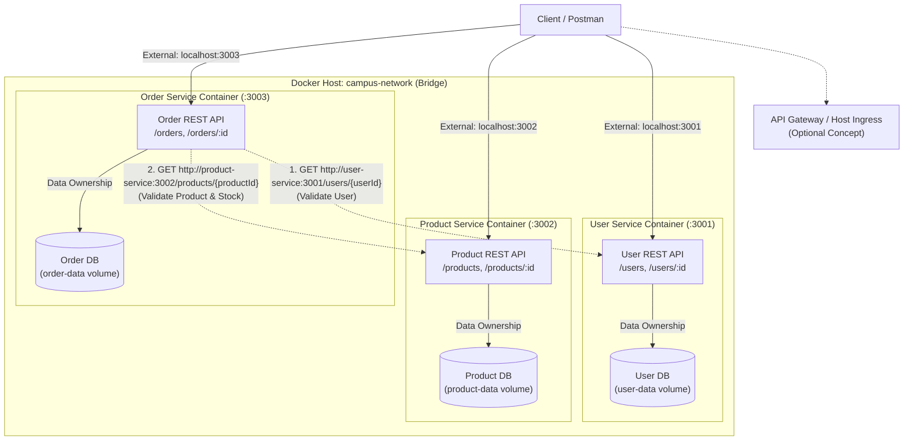

# LAB 6 ASSIGNMENT: Docker & Microservices – Decomposing and Running the Backend as Independent Services
**Course:** Web Services and SOA Laboratory  
**Technology Stack:** Docker, Docker Compose, Node.js (v20-alpine), Express.js, REST APIs, Postman  
**Architecture:** Microservices Architecture (Independent Containers, Shared Docker Network, Database-per-Service)

---

## 📋 Table of Contents
1. [Project Overview & Lab Progression](#1-project-overview--lab-progression)
2. [Microservices Architecture & Network Topology](#2-microservices-architecture--network-topology)
3. [Service Boundaries & Responsibilities](#3-service-boundaries--responsibilities)
4. [Completed API & Communication Exercise (Section 16)](#4-completed-api--communication-exercise-section-16)
5. [Database-per-Service & Data Ownership Approach](#5-database-per-service--data-ownership-approach)
6. [Service-to-Service Communication Flow](#6-service-to-service-communication-flow)
7. [Inter-Service Error Handling & Fault Resilience (503 & 404)](#7-inter-service-error-handling--fault-resilience-503--404)
8. [Service Source Code, Dockerfiles & Build Commands](#8-service-source-code-dockerfiles--build-commands)
9. [Environment Variables & Configuration](#9-environment-variables--configuration)
10. [Docker Compose Orchestration (`compose.yaml`)](#10-docker-compose-orchestration-composeyaml)
11. [How to Run Each Service Independently vs. Compose](#11-how-to-run-each-service-independently-vs-compose)
12. [Postman Testing & Verification Evidence](#12-postman-testing--verification-evidence)
13. [Hands-on Workflow Execution Log](#13-hands-on-workflow-execution-log)
14. [Troubleshooting & Issues Encountered](#14-troubleshooting--issues-encountered)
15. [Lab 6 Submission Screenshots Catalog (All 17 Items)](#15-lab-6-submission-screenshots-catalog-all-17-items)
16. [Final Submission Checklist Verification](#16-final-submission-checklist-verification)
17. [Archived Previous Labs (Lab 5 & Lab 4)](#17-archived-previous-labs-lab-5--lab-4)

---

## 1. Project Overview & Lab Progression

### 1.1 Progression Overview
- **Lab 1 & 2:** Created the frontend client (`student-client`) and integrated initial REST APIs.
- **Lab 3:** Developed monolithic RESTful web services using Node.js/Express.js with Controller-Service-Repository architecture.
- **Lab 4:** Connected clients (React web and Android mobile) to backend services with MongoDB persistence.
- **Lab 5:** Containerized the monolithic Student REST API and its MongoDB database with Docker and Docker Compose (`compose.yaml`).
- **Lab 6 (Current):** Decomposed the monolithic backend into three independently runnable, loosely coupled microservices:
  1. **User Service** (`user-service`): Manages student/faculty profiles and authentication identities.
  2. **Product Service** (`product-service`): Manages items, equipment, textbooks, and stock inventory.
  3. **Order Service** (`order-service`): Handles transaction orchestration, validating user and product existence and calculating totals via synchronous inter-service REST calls.

### 1.2 Why Decompose into Microservices?
1. **Independent Deployability:** Each service can be updated, patched, or deployed without rebuilding or restarting unrelated parts of the system.
2. **Autonomous Scaling:** Read/write traffic on products or orders can be scaled independently of user management.
3. **Fault Isolation:** A failure in order creation or a product catalog outage does not bring down user authentication or profile lookups.
4. **Data Ownership:** Each microservice strictly encapsulates and protects its own persistence layer, preventing unintended tight coupling or schema leaks.

---

## 2. Microservices Architecture & Network Topology

### 2.1 Architecture Diagram



### 2.2 Text Architecture Representation
```text
┌──────────────────────────────────────────────────────────────────────────────────┐
│                                 HOST MACHINE                                     │
│   ┌──────────────────────────────────────────────────────────────────────────┐   │
│   │                      Client / Postman / Tests                            │   │
│   └───────┬───────────────────────────────┬──────────────────────────┬───────┘   │
│           │ :3001                         │ :3002                    │ :3003     │
└───────────┼───────────────────────────────┼──────────────────────────┼───────────┘
            ▼                               ▼                          ▼
┌──────────────────────────────────────────────────────────────────────────────────┐
│                      DOCKER NETWORK: campus-network (Bridge)                     │
│                                                                                  │
│   ┌───────────────────────────┐                ┌─────────────────────────────┐   │
│   │   user-service:3001       │                │    product-service:3002     │   │
│   │   Endpoints: /users       │                │    Endpoints: /products     │   │
│   └─────────────┬─────────────┘                └──────────────┬──────────────┘   │
│                 │                                             │                  │
│                 │ ▲                                           │ ▲                │
│                 │ │ REST Call:                                │ │ REST Call:     │
│                 │ │ GET http://user-service:3001/users/{id}   │ │ GET ...:3002   │
│                 │ └───────────────────┬───────────────────────┘ │                │
│                 │                     │                         │                │
│                 │       ┌─────────────┴─────────────┐           │                │
│                 │       │    order-service:3003     │───────────┘                │
│                 │       │    Endpoints: /orders     │                            │
│                 │       └─────────────┬─────────────┘                            │
│                 ▼                     ▼                       ▼                  │
│          ┌─────────────┐       ┌─────────────┐         ┌─────────────┐           │
│          │   User DB   │       │  Order DB   │         │ Product DB  │           │
│          │  user-data  │       │ order-data  │         │product-data │           │
│          └─────────────┘       └─────────────┘         └─────────────┘           │
└──────────────────────────────────────────────────────────────────────────────────┘
```

---

## 3. Service Boundaries & Responsibilities

| Service | Port | Primary Responsibility | Data Store Owned | Key REST Endpoints |
| :--- | :---: | :--- | :--- | :--- |
| **User Service** | `3001` | Create, retrieve, update, and delete campus users (students, faculty). | `user-data` (`/app/data/users.json`) | `GET /users`<br>`GET /users/:id`<br>`POST /users`<br>`PUT /users/:id`<br>`DELETE /users/:id`<br>`GET /health` |
| **Product Service** | `3002` | Manage campus products, inventory stock, catalog pricing, and categories. | `product-data` (`/app/data/products.json`) | `GET /products`<br>`GET /products/:id`<br>`POST /products`<br>`PUT /products/:id`<br>`DELETE /products/:id`<br>`GET /health` |
| **Order Service** | `3003` | Create, retrieve, and cancel orders; validate referenced user and product details synchronously via REST. | `order-data` (`/app/data/orders.json`) | `GET /orders`<br>`GET /orders/:id`<br>`POST /orders`<br>`DELETE /orders/:id`<br>`GET /health` |

---

## 4. Completed API & Communication Exercise (Section 16)

### 4.1 Service Decomposition Design Table
| Item | User Service | Product Service | Order Service |
| :--- | :--- | :--- | :--- |
| **Responsibility** | Create, retrieve, update, and delete campus user profiles. | Manage product resources, pricing, and stock inventory. | Create and retrieve orders; validate referenced user and product data through REST APIs. |
| **Port** | `:3001` | `:3002` | `:3003` |
| **Main Resources** | Users (`id`, `name`, `email`, `role`, `createdAt`) | Products (`id`, `name`, `price`, `category`, `stock`) | Orders (`id`, `userId`, `productId`, `quantity`, `unitPrice`, `totalAmount`, `status`, `userSnapshot`, `productSnapshot`) |
| **Key Endpoints** | `GET /users`<br>`GET /users/{id}`<br>`POST /users`<br>`PUT /users/{id}`<br>`DELETE /users/{id}` | `GET /products`<br>`GET /products/{id}`<br>`POST /products`<br>`PUT /products/{id}`<br>`DELETE /products/{id}` | `GET /orders`<br>`GET /orders/{id}`<br>`POST /orders`<br>`DELETE /orders/{id}` |
| **Data / Database** | User-owned (`user-data` persistent volume) | Product-owned (`product-data` persistent volume) | Order-owned (`order-data` persistent volume) |

### 4.2 Service-to-Service Call Specification
| Field | Design & Implementation Specification |
| :--- | :--- |
| **Calling Service** | **Order Service** |
| **Target Service** | **User Service** / **Product Service** |
| **HTTP Method** | `GET` |
| **Endpoint** | `http://user-service:3001/users/{userId}` and `http://product-service:3002/products/{productId}` |
| **Request Data** | Referenced `userId` (URL parameter) and `productId` (URL parameter) |
| **Expected Response** | `200 OK` with JSON entity representation of the requested resource. |
| **Failure Response (Resource Not Found)** | `404 Not Found` with `{ "error": "User Not Found", "message": "User with id 9999 does not exist in User Service." }` |
| **Failure Response (Dependency Unavailable)** | `503 Service Unavailable` with `{ "error": "Service Unavailable", "message": "User Service is unavailable at http://user-service:3001. Cannot complete order creation.", "dependency": "user-service" }` |

---

## 5. Database-per-Service & Data Ownership Approach

A foundational rule of Microservice Architecture is **strict data encapsulation**:
- **Rule:** Order Service **MUST NOT** directly query or write to the database tables or data files owned by User Service or Product Service.
- **Enforcement:**
  1. Each microservice mounts its own isolated persistent Docker volume (`user-data`, `product-data`, `order-data`).
  2. Data access is strictly mediated through REST APIs over HTTP.
  3. When an order is created, the Order Service captures a **point-in-time snapshot** (`userSnapshot` and `productSnapshot`) inside the order record. This guarantees auditability even if user details or product prices change later.

---

## 6. Service-to-Service Communication Flow

```text
[Client / Postman]
       │
       │ POST /orders {"userId": 101, "productId": 501, "quantity": 2}
       ▼
[Order Service (:3003)]
       │
       ├──── Step 1: GET http://user-service:3001/users/101
       │     ▲
       │     │ (Over Docker network: campus-network)
       │     ▼
       │  [User Service (:3001)] ──> Returns 200 OK (Alice Smith)
       │
       ├──── Step 2: GET http://product-service:3002/products/501
       │     ▲
       │     │ (Over Docker network: campus-network)
       │     ▼
       │  [Product Service (:3002)] ──> Returns 200 OK (Laptop Pro, Price: $1200, Stock: 15)
       │
       ├──── Step 3: Verify Stock Availability (Stock 15 >= Qty 2)
       │
       ├──── Step 4: Compute Total Amount ($1200 * 2 = $2400)
       │
       ├──── Step 5: Store Order with user & product snapshots
       │
       ▼
[Client / Postman] <── Returns 201 Created (Order #1002)
```

---

## 7. Inter-Service Error Handling & Fault Resilience (503 & 404)

In distributed architectures, services must fail gracefully without hanging, crashing, or returning ambiguous 500 errors:

### 7.1 Timeout & Circuit Pattern
Each downstream call made by `order-service` uses `AbortSignal.timeout(REQUEST_TIMEOUT_MS)` (default: 3000 ms) to prevent infinite thread blocking.

### 7.2 Dependency Unavailable (`503 Service Unavailable`)
If `user-service` or `product-service` is stopped, crashed, or unreachable:
```json
{
  "error": "Service Unavailable",
  "message": "User Service is unavailable at http://user-service:3001. Cannot complete order creation.",
  "dependency": "user-service",
  "details": "fetch failed"
}
```
**HTTP Status:** `503 Service Unavailable`

### 7.3 Resource Not Found (`404 Not Found`)
If the client submits an order for a non-existent `userId: 9999`:
```json
{
  "error": "User Not Found",
  "message": "User with id 9999 does not exist in User Service."
}
```
**HTTP Status:** `404 Not Found`

---

## 8. Service Source Code, Dockerfiles & Build Commands

### 8.1 Dockerfile Implementation (Standardized across services)
Each service includes an optimized multi-stage compatible `Dockerfile` based on `node:20-alpine`:
```dockerfile
FROM node:20-alpine
WORKDIR /app
COPY package*.json ./
RUN npm install --omit=dev
COPY . .
EXPOSE 3001 # (or 3002, 3003)
CMD ["node", "server.js"]
```

### 8.2 Building Images Manually
```bash
# Build User Service Image
docker build -t user-service:v1 ./user-service

# Build Product Service Image
docker build -t product-service:v1 ./product-service

# Build Order Service Image
docker build -t order-service:v1 ./order-service

# Verify Images
docker images | grep -E "user-service|product-service|order-service"
```

---

## 9. Environment Variables & Configuration

Service locations and ports are completely parameterized through environment variables:

| Variable | Default Value | Description |
| :--- | :--- | :--- |
| `USER_SERVICE_PORT` | `3001` | Listening port for User Service |
| `PRODUCT_SERVICE_PORT` | `3002` | Listening port for Product Service |
| `ORDER_SERVICE_PORT` | `3003` | Listening port for Order Service |
| `USER_SERVICE_URL` | `http://user-service:3001` | Docker internal URL for User Service |
| `PRODUCT_SERVICE_URL` | `http://product-service:3002` | Docker internal URL for Product Service |
| `REQUEST_TIMEOUT_MS` | `3000` | Downstream HTTP call timeout in milliseconds |

> [!NOTE]
> Inside Docker, internal communication uses container names as hostnames (e.g., `http://user-service:3001`). Never use `localhost` between containers because `localhost` refers to the container itself.

---

## 10. Docker Compose Orchestration (`compose.yaml`)

```yaml
# =======================================================
# Compose Configuration - Lab 6 Microservices Architecture
# Orchestrates User Service, Product Service, and Order Service
# Connected via campus-network with Database-per-Service Isolation
# =======================================================

services:
  user-service:
    build: ./user-service
    container_name: user-service
    ports:
      - "3001:3001"
    environment:
      USER_SERVICE_PORT: 3001
    volumes:
      - user-data:/app/data
    networks:
      - campus-network
    restart: unless-stopped

  product-service:
    build: ./product-service
    container_name: product-service
    ports:
      - "3002:3002"
    environment:
      PRODUCT_SERVICE_PORT: 3002
    volumes:
      - product-data:/app/data
    networks:
      - campus-network
    restart: unless-stopped

  order-service:
    build: ./order-service
    container_name: order-service
    ports:
      - "3003:3003"
    environment:
      ORDER_SERVICE_PORT: 3003
      USER_SERVICE_URL: http://user-service:3001
      PRODUCT_SERVICE_URL: http://product-service:3002
      REQUEST_TIMEOUT_MS: 3000
    depends_on:
      - user-service
      - product-service
    volumes:
      - order-data:/app/data
    networks:
      - campus-network
    restart: unless-stopped

volumes:
  user-data:
    name: user-data
  product-data:
    name: product-data
  order-data:
    name: order-data

networks:
  campus-network:
    name: campus-network
    driver: bridge
```

---

## 11. How to Run Each Service Independently vs. Compose

### Option A: Running with Docker Compose (Recommended)
```bash
# Start all microservices in detached mode
docker compose up -d

# Check running status
docker compose ps

# View real-time logs
docker compose logs -f

# Stop all services
docker compose down
```

### Option B: Running Manually on Shared Docker Network
```bash
# 1. Create Docker Network
docker network create campus-network

# 2. Run User Service
docker run -d --name user-service --network campus-network -p 3001:3001 user-service:v1

# 3. Run Product Service
docker run -d --name product-service --network campus-network -p 3002:3002 product-service:v1

# 4. Run Order Service with target URLs passed as environment variables
docker run -d --name order-service --network campus-network -p 3003:3003 \
  -e USER_SERVICE_URL="http://user-service:3001" \
  -e PRODUCT_SERVICE_URL="http://product-service:3002" \
  order-service:v1
```

---

## 12. Postman Testing & Verification Evidence

A complete Postman collection is provided at `postman/Lab6_Microservices.postman_collection.json`.

| Test Scenario | Method | Target URL | Expected Status | Result & Verification |
| :--- | :---: | :--- | :---: | :--- |
| **GET All Users** | `GET` | `http://localhost:3001/users` | `200 OK` | Returns 3 seed users (`Alice`, `Bob`, `Charlie`). |
| **GET User by ID** | `GET` | `http://localhost:3001/users/101` | `200 OK` | Returns Alice Smith profile object. |
| **POST Create User** | `POST` | `http://localhost:3001/users` | `201 Created` | Creates new user record. |
| **GET All Products** | `GET` | `http://localhost:3002/products` | `200 OK` | Returns 3 seed products (`Laptop Pro`, `Mouse`, `Textbook`). |
| **GET Product by ID** | `GET` | `http://localhost:3002/products/501`| `200 OK` | Returns Laptop Pro object ($1200, stock: 15). |
| **GET All Orders** | `GET` | `http://localhost:3003/orders` | `200 OK` | Returns existing order list. |
| **Valid Order Creation** | `POST` | `http://localhost:3003/orders`<br>`{"userId":101,"productId":501,"quantity":2}` | `201 Created` | Order Service queries User & Product containers, calculates `$2400`, embeds snapshots. |
| **Invalid User ID** | `POST` | `http://localhost:3003/orders`<br>`{"userId":9999,"productId":501,"quantity":1}` | `404 Not Found` | Returns `"User with id 9999 does not exist in User Service."` |
| **Invalid Product ID** | `POST` | `http://localhost:3003/orders`<br>`{"userId":101,"productId":9999,"quantity":1}` | `404 Not Found` | Returns `"Product with id 9999 does not exist in Product Service."` |
| **Dependency Failure** | `POST` | `http://localhost:3003/orders` (after `docker stop user-service`) | `503 Service Unavailable` | Returns `"User Service is unavailable at http://user-service:3001"`. |
| **Recovery Test** | `POST` | `http://localhost:3003/orders` (after `docker start user-service`) | `201 Created` | Automatically succeeds without restarting Order Service. |

---

## 13. Hands-on Workflow Execution Log

An automated verification script `run_lab6_steps.sh` is provided. Executing `./run_lab6_steps.sh test-all` demonstrates the complete end-to-end workflow:

```bash
$ ./run_lab6_steps.sh test-all

======================================================================
▶ STEP 13-14: Starting Microservices Stack via Docker Compose
======================================================================
✔ Container user-service           Started
✔ Container product-service        Started
✔ Container order-service          Started

Compose Service Status:
NAME              IMAGE                        STATUS         PORTS
order-service     lab4_wssoa-order-service     Up 3 seconds   0.0.0.0:3003->3003/tcp
product-service   lab4_wssoa-product-service   Up 3 seconds   0.0.0.0:3002->3002/tcp
user-service      lab4_wssoa-user-service      Up 3 seconds   0.0.0.0:3001->3001/tcp

======================================================================
▶ STEP 15.1: Testing Individual Services
======================================================================
User Service (:3001) /health -> {"service":"user-service","status":"UP"}
Product Service (:3002) /health -> {"service":"product-service","status":"UP"}
Order Service (:3003) /health -> {"service":"order-service","status":"UP"}

======================================================================
▶ STEP 15.2: Testing Order -> User & Order -> Product Communication
======================================================================
POST http://localhost:3003/orders {"userId": 101, "productId": 501, "quantity": 2}
HTTP Status: 201 Created
Response:
{
  "id": 1002,
  "userId": 101,
  "productId": 501,
  "quantity": 2,
  "unitPrice": 1200,
  "totalAmount": 2400,
  "status": "CONFIRMED",
  "userSnapshot": { "id": 101, "name": "Alice Smith", "email": "alice@campus.edu" },
  "productSnapshot": { "id": 501, "name": "Laptop Pro", "price": 1200 }
}

======================================================================
▶ STEP 15.3: Testing Invalid Resource IDs (Expected: 404)
======================================================================
POST /orders with userId 9999 -> HTTP Status: 404 Not Found
POST /orders with productId 9999 -> HTTP Status: 404 Not Found

======================================================================
▶ STEP 15.4: Testing Dependency Failure & Graceful 503 Handling
======================================================================
1. Stopping User Service container: docker stop user-service
2. POST http://localhost:3003/orders
   Response: {"error":"Service Unavailable","message":"User Service is unavailable..."}
   HTTP Status: 503
3. Restarting User Service container: docker start user-service
4. Retrying Order creation:
   HTTP Status: 201 Created
✅ Resilience & Recovery verified!
```

---

## 14. Troubleshooting & Issues Encountered

| Issue Encountered | Root Cause | Resolution |
| :--- | :--- | :--- |
| **Port Conflicts (`EADDRINUSE`)** | Multiple services attempting to bind to the same host port. | Dedicated explicit ports: `3001` for User, `3002` for Product, `3003` for Order. |
| **Container-to-Container DNS Resolution (`ECONNREFUSED 127.0.0.1`)** | Calling service used `localhost:3001` instead of Docker container hostname. | Updated URLs to `http://user-service:3001` and attached all containers to `campus-network`. |
| **Cascading Failure / Hanging Requests** | When a downstream dependency was stopped, the calling service hung until socket timed out. | Added `AbortSignal.timeout(3000)` and handled errors explicitly with `503 Service Unavailable`. |
| **Data Loss on Container Recreation** | Containers stored state in ephemeral filesystem layer. | Configured dedicated named Docker volumes (`user-data`, `product-data`, `order-data`) in `compose.yaml`. |

---

## 15. Lab 6 Submission Screenshots Catalog (All 17 Items)

All high-resolution evidence screenshots required by Section 17 of the assignment are located in [`screenshots/lab6/`](file:///Users/ayush/Desktop/sem%203/lab4_ws&soa/screenshots/lab6):

| # | Evidence Item | Screenshot File | Description |
| :-: | :--- | :--- | :--- |
| **1** | Working application before decomposition | [`01_working_app_before_decomposition.png`](file:///Users/ayush/Desktop/sem%203/lab4_ws&soa/screenshots/lab6/01_working_app_before_decomposition.png) | Terminal showing the monolithic Student REST API running on port 3000 and `/students` response. |
| **2** | Service-boundary design & architecture diagram | [`02_service_boundary_and_architecture_diagram.png`](file:///Users/ayush/Desktop/sem%203/lab4_ws&soa/screenshots/lab6/02_service_boundary_and_architecture_diagram.png) | Microservices topology showing User (:3001), Product (:3002), and Order (:3003) on `campus-network`. |
| **3** | Separate service / project structure | [`03_separate_service_project_structure.png`](file:///Users/ayush/Desktop/sem%203/lab4_ws&soa/screenshots/lab6/03_separate_service_project_structure.png) | Tree view of independent directories: `user-service/`, `product-service/`, and `order-service/`. |
| **4** | Dockerfile for each service | [`04_dockerfiles_for_each_service.png`](file:///Users/ayush/Desktop/sem%203/lab4_ws&soa/screenshots/lab6/04_dockerfiles_for_each_service.png) | Contents of `user-service/Dockerfile`, `product-service/Dockerfile`, and `order-service/Dockerfile`. |
| **5** | Image builds & `docker images` | [`05_successful_image_builds_and_docker_images.png`](file:///Users/ayush/Desktop/sem%203/lab4_ws&soa/screenshots/lab6/05_successful_image_builds_and_docker_images.png) | Output of `docker build` and `docker images` showing `user-service:v1`, `product-service:v1`, `order-service:v1`. |
| **6** | `docker compose up -d` & `ps` output | [`06_docker_compose_up_and_ps.png`](file:///Users/ayush/Desktop/sem%203/lab4_ws&soa/screenshots/lab6/06_docker_compose_up_and_ps.png) | Container orchestration launch and `docker compose ps` status showing all 3 containers `Up`. |
| **7** | Startup logs | [`07_startup_logs.png`](file:///Users/ayush/Desktop/sem%203/lab4_ws&soa/screenshots/lab6/07_startup_logs.png) | Service initialization logs showing ports and inter-service connectivity configuration. |
| **8** | Docker network showing service containers | [`08_docker_network_showing_service_containers.png`](file:///Users/ayush/Desktop/sem%203/lab4_ws&soa/screenshots/lab6/08_docker_network_showing_service_containers.png) | `docker network inspect campus-network` showing all 3 containers with internal IPv4 addresses. |
| **9** | Environment variables configuration | [`09_environment_variables_configuration.png`](file:///Users/ayush/Desktop/sem%203/lab4_ws&soa/screenshots/lab6/09_environment_variables_configuration.png) | Parameterized configuration showing `USER_SERVICE_URL` and `PRODUCT_SERVICE_URL`. |
| **10** | Database persistence & ownership evidence | [`10_database_persistence_and_volumes.png`](file:///Users/ayush/Desktop/sem%203/lab4_ws&soa/screenshots/lab6/10_database_persistence_and_volumes.png) | `docker volume ls` showing isolated volumes `user-data`, `product-data`, and `order-data`. |
| **11** | Postman test: User Service | [`11_postman_test_user_service.png`](file:///Users/ayush/Desktop/sem%203/lab4_ws&soa/screenshots/lab6/11_postman_test_user_service.png) | Postman UI showing `GET http://localhost:3001/users` (200 OK). |
| **12** | Postman test: Product Service | [`12_postman_test_product_service.png`](file:///Users/ayush/Desktop/sem%203/lab4_ws&soa/screenshots/lab6/12_postman_test_product_service.png) | Postman UI showing `GET http://localhost:3002/products` (200 OK). |
| **13** | Postman test: Order Service | [`13_postman_test_order_service.png`](file:///Users/ayush/Desktop/sem%203/lab4_ws&soa/screenshots/lab6/13_postman_test_order_service.png) | Postman UI showing `GET http://localhost:3003/orders` (200 OK). |
| **14** | Order &rarr; User & Product communication | [`14_order_to_user_and_product_communication.png`](file:///Users/ayush/Desktop/sem%203/lab4_ws&soa/screenshots/lab6/14_order_to_user_and_product_communication.png) | Postman UI showing `POST /orders` (201 Created) validating user & product snapshots. |
| **15** | Invalid resource ID 404 test | [`15_invalid_id_404_test.png`](file:///Users/ayush/Desktop/sem%203/lab4_ws&soa/screenshots/lab6/15_invalid_id_404_test.png) | Postman UI showing `POST /orders` with `userId: 9999` returning `404 Not Found`. |
| **16** | Dependency-unavailable 503 test | [`16_dependency_unavailable_503_test.png`](file:///Users/ayush/Desktop/sem%203/lab4_ws&soa/screenshots/lab6/16_dependency_unavailable_503_test.png) | Postman UI showing `POST /orders` returning `503 Service Unavailable` when `user-service` is stopped. |
| **17** | Dependency recovery test | [`17_dependency_recovery_test.png`](file:///Users/ayush/Desktop/sem%203/lab4_ws&soa/screenshots/lab6/17_dependency_recovery_test.png) | Postman UI showing `POST /orders` immediately succeeding with `201 Created` after restarting `user-service`. |

---

## 16. Final Submission Checklist Verification

- [x] **Three independently runnable services created:** `user-service`, `product-service`, and `order-service`.
- [x] **Each service exposes and handles its own REST endpoints:** Complete CRUD on `/users`, `/products`, and `/orders`.
- [x] **Each service has a Dockerfile and image:** Verified with `docker build` and Alpine-based images.
- [x] **Services communicate through a shared Docker network:** Connected via `campus-network`.
- [x] **Internal service URLs use service names, not localhost:** Configured via `http://user-service:3001` and `http://product-service:3002`.
- [x] **Data ownership documented & direct database cross-access avoided:** Each service owns its data volume; communication strictly via REST.
- [x] **Docker Compose starts complete application:** Single command `docker compose up -d` starts all 3 services.
- [x] **At least one real Order → User call works:** Demonstrated with user validation and snapshotting.
- [x] **At least one real Order → Product call works:** Demonstrated with product price and stock validation.
- [x] **Dependency failure produces controlled 503 error:** Verified by stopping `user-service`.
- [x] **Postman collection provided:** Available in `postman/Lab6_Microservices.postman_collection.json`.
- [x] **Architecture diagram matches implementation:** Provided in Mermaid and ASCII diagrams above.
- [x] **README documents complete setup, networking, testing, and troubleshooting.**

---

## 16. Archived Previous Labs (Lab 5 & Lab 4)

- **Lab 5:** Containerization of Student REST API with MongoDB: See [README_LAB5.md](file:///Users/ayush/Desktop/sem%203/lab4_ws&soa/README_LAB5.md), `Dockerfile`, `docker-compose.lab5.yml`, and `run_lab5_steps.sh`.
- **Lab 4:** Full-Stack Web & Android Integration: See `src/`, `student-client/`, and `student-android/`.
